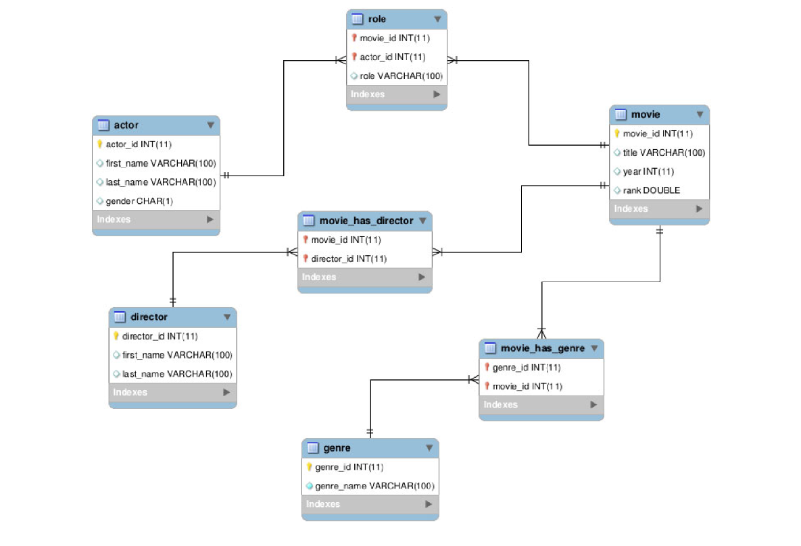

## Part 2: SQL Queries

The second module of the project focuses on querying a relational movie database (simplified version of `movies` database schema).

### Database Schema

* `actor` (`actor_id`, `first_name`, `last_name`, `gender`, `film_count`)
* `director` (`director_id`, `first_name`, `last_name`)
* `movie` (`movie_id`, `title`, `year`, `rank`)
* `genre` (`genre_id`, `genre_name`)
* `role` (`movie_id`, `actor_id`, `role`)
* `movie_has_genre` (`genre_id`, `movie_id`)
* `movie_has_director` (`movie_id`, `director_id`)

---

### Key Query Objectives 

`queries.sql` covers the following relational database queries:

1. **Genre & Actor Filtering:** Retrieves movie titles featuring actors named "Allen" within the "Comedy" genre.
2. **Multi-Genre Director Aggregation:** Finds directors and movies starring "Allen" where the director has directed at least two distinct film genres.
3. **Complex Director-Actor Name Relationships:** Identifies actors who have starred in films directed by a director with the same surname, as well as films with different directors under specific genre-matching criteria.
4. **Conditional Existence Verification:** Checks for the presence of 1995 "Drama" movies without using flow control operators (`IF`, `CASE`), returning a single boolean status (`yes`/`no`).
5. **Director Co-Direction Analytics:** Finds unique pairs of directors who co-directed movies between 2000 and 2006 with cross-genre coverage (at least 6 different genres), avoiding duplicate pair reporting.
6. **Actor Portfolio Statistics:** Aggregates first/last names and distinct director counts for actors who have appeared in exactly 3 movies.
7. **Single-Genre Movie Metrics:** Identifies single-genre movies and calculates the total count of directors involved in that genre.
8. Finds actor IDs who have appeared in movies across **all** available genres.
9. For every distinct pair of movie genres(`genre_id` pairs) computes counts of directors that have directed movies of both genres.
10. Finds actor participation counts per genre where the underlying movies are directed exclusively by directors dedicated to that single genre.

---
